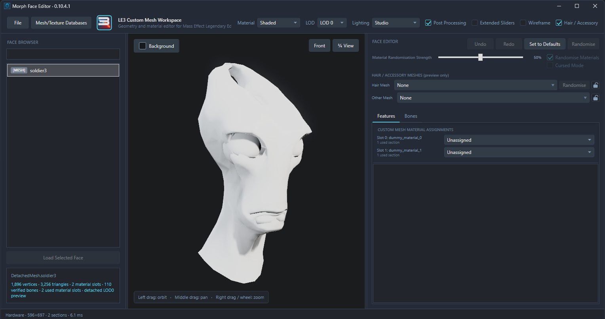
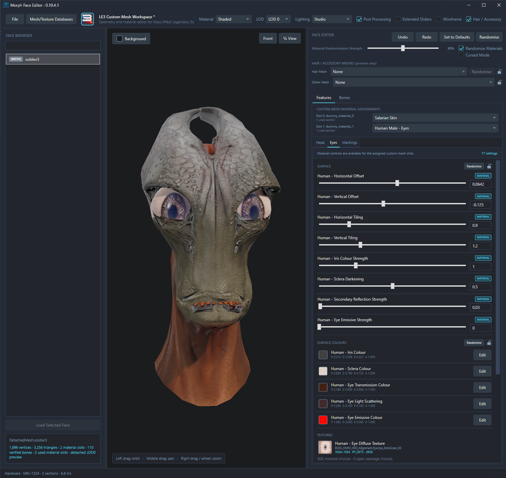
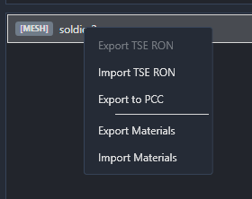
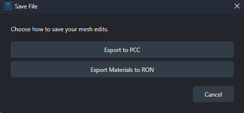

# Custom Meshes

A custom head mesh can be brought into MFE and previewed with the game's head materials. Colours, textures and material settings can then be edited, with the result exported to PCC or the settings saved as a material RON.

This is an advanced workflow for mod developers. The mesh should already be prepared in your modelling tool; MFE handles the material setup and preview. This mode only supports materials used by the game's morph faces - it does not support every face material in the game.

For the normal editing and camera controls, see [Editing Faces](EDITING-FACES.md).

## Import the mesh

1. The **Mesh/Texture Database** for the game you'll be using should be built first. Setup is covered in [Getting Started](GETTING-STARTED.md).
2. Import your mesh through **File → Open File** (Ctrl+O), or drag it onto the window. **PSK**, **PSKX**, **glTF** and **GLB** files are supported.
3. Select your target LE game when prompted, then enter a name for your imported mesh.
4. Your mesh will be opened in a **Custom Mesh Workspace**, ready for its materials to be assigned.

A recognised player mesh may be opened through the [Player Faces](PLAYER-FACES.md) workflow instead if MFE detects it is valid. If it was previously exported by MFE, its accompanying `.mfe.json` file should be kept beside the mesh with its matching filename when it's brought back in.

Without a database, only a limited selection of Human material assets will be available, with no alien materials. If the database is built after the mesh has been opened, the mesh should be reimported to pick up the new choices.

## Assign the materials

Under **Features**, the **CUSTOM MESH MATERIAL ASSIGNMENTS** section contains a selector for each used material slot. The slot number and the material name from the imported mesh are shown beside it.

1. A material family is selected from each slot's dropdown. Slots start as **Unassigned**.
2. The choice should match the part of the mesh using that slot: a face material for the head, an eye material for the eyes etc. Available choices depend on the game and installed assets.
3. Once materials have been assigned, their controls will appear in the Features categories below.

Related dropdown variants are grouped together here:

| Materials | Games |
| --- | --- |
| Human Face & Scalp (NPC/Player variations), Eyes and Lashes | ALL   |
| Human Hair / Human Advanced Hair | ALL |
| James Vega Hair | LE3 ONLY   |
| Asari Head   | ALL |
| Salarian Head & Eyes | ALL |
| Turian Head & Eyes | ALL |
| Krogan Head & Eyes | ALL |
| Batarian Head | ALL |
| Vorcha Head & Eyes | LE2 & LE3 ONLY  |

The material choice doesn't change the mesh's UVs. A Human face material can be put on a custom mesh, but the textures you choose still need to fit that mesh's UV layout. MFE won't magically rearrange the face for you, sorry.

Up to **eight distinct used material slots** on a single mesh are supported. Several mesh sections sharing one material slot only count once. Above eight, the complete mesh can still be previewed, but the custom material assignments aren't available. Hair/attachment meshes are preview only - they won't be exported with your edits.

## Edit the appearance

The assigned materials can be edited using the usual material sliders, colour pickers and texture dropdowns. Their supported controls are grouped into the Features categories, just as they are for a normal face.

Controls shared by several assigned materials are edited together. For example, if two slots expose the same supported colour parameter (such as SkinTone), its value is shared between them; a separate copy of every control isn't shown for each slot.

Lighting, **Post Processing**, **Wireframe** and the other preview options can be used to inspect the result. **Undo** (Ctrl+Z) and **Redo** (Ctrl+Y) are available while experimenting.

### Morphs, bones and attachments

Morph sliders aren't available for a custom mesh. The **Bones** tab is available only if the imported rig can be verified; a mesh without a suitable rig can still be previewed and have its materials edited.

Still, bone adjustments in this workspace are for preview only. The PCC export uses the imported mesh and its supplied rig where present, and a material RON doesn't contain those bone adjustments.

Hair and accessory selectors are also preview only. Those meshes aren't added to the imported mesh or included in its PCC export. References to them can be saved in a material RON and restored for preview, but the attachment meshes themselves aren't embedded in that file. Custom Mesh workspaces are ultimately intended for live material editing.

## Export the result

The available outputs do different jobs:

| Output | What's saved |
| --- | --- |
| **Export to PCC** | The imported mesh, assigned material instances and their required assets, in a new PCC. |
| **Export Materials** | An MFE material RON containing the material settings. The mesh geometry isn't included. |
| **Export TSE RON** | A TSE-compatible material preset for Human materials. This is material data, rather than a full headmorph. |

The original imported mesh file isn't overwritten by these exports.

### Export to PCC

Every used material slot must have a material assigned before the mesh can be exported to PCC. Any slots still marked **Unassigned** need to be set up first.

1. **Export to PCC** is selected from the mesh's right-click menu in the Face Browser.
2. In **Save Mesh and Materials to PCC**, a destination filename is chosen.
3. The export is completed with **Save**.

A new PCC is created by this operation. Choosing an existing filename offers to overwrite it; the mesh isn't added to that existing package as it would be through the NPC face export workflow.

The output contains a **SkeletalMesh** and its materials. It can then be brought into your mod with Legendary Explorer and assigned where needed. A BioMorphFace or any actor assignment isn't created or handled by this export.

Unrigged meshes can also be exported, but only a minimal root skeleton is added. A working character rig still needs to be prepared in your modelling tool.

### Save a material preset

**Export Materials** in the mesh's right-click menu saves the current settings to an MFE RON. This is useful when the same appearance will be reused, or when the material setup is being worked out before it's applied elsewhere.

**File → Save File** (Ctrl+S) also offers a choice between **Export to PCC** and **Export Materials to RON**. The output should be chosen based on whether the mesh itself is needed or just its material settings.

## Reuse material settings

1. Open your custom mesh and assign the material slots.
2. **Import Materials** is selected from the mesh's right-click menu (or drag a compatible RON onto the editor)
3. Any matching material settings will then be applied to the current setup. The RON must be for the same game.

Importing a preset keeps the current slot assignments. Only settings supported by those assigned materials are applied; unmatched settings are ignored. The materials should therefore be set up before the preset is imported, rather than expecting it to choose them for you.

For a TSE material preset, **Import TSE RON** is used instead, with a Human material assigned first. **Export TSE RON** is available when at least one material has been assigned and all assigned materials are Human. A MFE material RON can be used for mixed Human and alien material setups. If you want to violate the laws of nature and put googly human eyes on a Salarian, who am I to stand in your way?

[Back to the documentation](../README.md#documentation)
