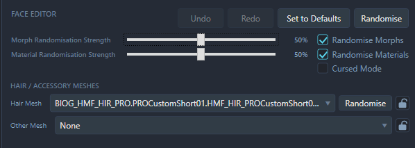
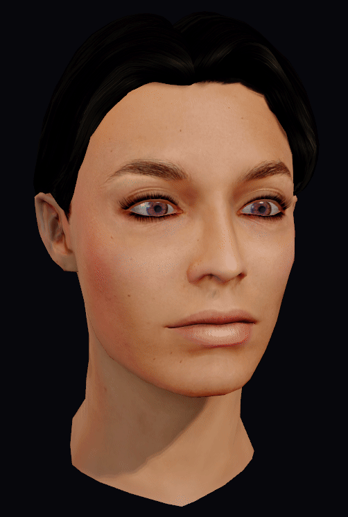

# Editing Faces

Once a face has been loaded, its appearance can be adjusted in the **Face Editor** on the right, with the result shown in the live preview. If you haven't opened a face yet, start with [Getting Started](GETTING-STARTED.md). For Shepard career saves and player headmorphs, see [Player Faces](PLAYER-FACES.md).

The controls offered depend on the face and the workspace. If a control isn't available, that doesn't necessarily mean anything has gone wrong: some faces or meshes don't support every kind of edit.

## Features

The **Features** tab is divided into categories for different sections of the face. Within each category, the controls are organised into groups. Depending on the face, morph sliders for shape might appear next to material scalars. Material basics are covered in [Getting Started](GETTING-STARTED.md).

Values can be changed by dragging a slider, opening a colour wheel, or using a texture dropdown, with the result shown in the preview. For more precise adjustments, a number can be typed into the box beside it. A value can also be changed with the scroll wheel over the number box: the normal step is 0.1, holding **Ctrl** changes it by 1, and holding **Shift** changes it by 10. God help you if you hold Shift.

Values outside the displayed slider range can be typed in, though extremes can produce unusual results.

An edit can be taken back with **Undo** (Ctrl+Z) and reapplied with **Redo** (Ctrl+Y). A slider drag is treated as one edit, so every tiny movement doesn't have to be undone separately.

**Set to Defaults** is a much broader reset: editable morph sliders are set to zero, bone positions are restored to their loaded defaults, and material values and textures are reset to their defaults. It doesn't simply return every setting to the appearance the face had when it was opened. The reset can be undone.

### Extended Sliders

**Extended Sliders** is an optional advanced control above the preview. It extends the slider ranges to include negative values. While BioWare's own faces only use positive values, technically those values can go in either direction. Switching this on changes the slider range, not the face by itself, so 0 becomes the midpoint of the slider instead of the leftpoint. Small changes are a good place to start, as extreme values can produce unusual shapes or material results. Extended Sliders are considered an advanced feature.

## Repair a face with Fix Morph

If a face's saved shape doesn't match its slider values, MFE may offer **Fix Morph** below **Load Selected Face** in the Face Browser. This rebuilds the face from its current slider values so morph editing can work again.

Click **Fix Morph**, then check the result in the preview. The rebuilt shape can look different from the one you opened; use **Undo** (Ctrl+Z) if you prefer the original. Save or export the face through your normal workflow to keep the repair.

The button only appears when MFE finds a mismatch it can repair. Vorcha and unverified custom geometry don't support this repair.

## Randomising a face

The **Randomise** button at the top of the Face Editor can provide a starting point or a fresh idea. What gets included is chosen with the checkboxes beside the strength controls:

- **Randomise Morphs** includes eligible shape controls.
- **Randomise Materials** includes eligible material changes.
- Morph/**Material Randomisation Strength** controls the strength of the randomisation's variation from the seed. A strength of 0% is effectively the same as picking a random vanilla head from the trilogy.

The two strengths can be adjusted separately. Availability varies with the face and the assets available, so some options may be disabled. Vorcha for example do not have morph sliders, so only material randomisation is possible. Undo can be used if you don't like a roll.

Categories and groups can be kept out of randomisation using the padlocks beside them, so the parts you already like can be left alone. Some groups also have their own **Randomise** button, which rolls just that group; texture buttons operate on eligible paired texture families. The hair mesh can have its own randomise control and lock too. A locked group can be unlocked when you want it included again. Some hairs also include linked scalp textures (such as Braids) and will keep them paired where possible.

**Cursed Mode**, inspired by the Mass Effect Randomiser mod, is there for more extreme and unpredictable results for those who wish to be confronted with horrors (or laughs) beyond imagination,. Enabling it selects the available morph and material options; the face is rolled when **Randomise** is pressed. Bones can be affected as well as shapes and materials where supported. A cursed roll can be undone too.

As a rule of thumb, Cursed morph randomisation gets expontentially more cursed with humans because of how many sliders there are. Even a strength of 15% will produce an extremely messed up face. The 50% default typically produces a mash explosion, unlike aliens which can survive higher values.

## Looking around the preview

The preview is there to help you inspect your work as you go:

- **Left-drag** to orbit, **middle-drag** to pan, and **right-drag** or use the mouse wheel to zoom.
- **Front** and **¾ View** return the camera to those views. **Background** opens a colour picker for the preview background. To restore the background for your current interface theme, click **Use theme default**, then **Apply**.
- The **Material** menu offers **Shaded**, **Unlit** and **Diagnostic** views. Shaded is useful for normal inspection; Unlit shows the face without the preview lighting, while Diagnostic uses colours to distinguish material families.
- **Lighting** offers **Studio**, **High Contrast**, **Warm Interior**, **Cool Night** and **Cinematic**. A face can look quite different under each, so it's useful to check more than one. **Post Processing** toggles the preview's presentation effects, and **Wireframe** shows the mesh structure.
- **Hair / Accessory** shows or hides the resolved attachment in the preview. This checkbox doesn't remove or replace the mesh. The actual selection can be changed using the hair or accessory mesh controls above the Features tab.
- **LOD** selects which level of detail is shown in the preview. Some LODs are marked **static**, and morph controls may be unavailable for a selected LOD or for features that don't affect it. Choosing an LOD changes the view; it doesn't by itself edit or export the face.

The preview is a guide, so the saved result should be checked in-game too. Changing the camera, lighting or other preview settings won't itself change the exported appearance.

The same face under different lighting presets:

## Bones (advanced)

The **Bones** tab is for more advanced adjustments and can be left alone while learning the normal Features controls. It is available only where the face has a suitable rig.

A bone can be moved in 3D space using a puck controller. Dragging the puck moves the bone up/down/left/right, while the scroll wheel moves the bone forward/backward.

A selected bone's **Reset** restores that bone to its original loaded position; it doesn't reset the whole face. Bone edits can also be undone.

When you're happy with the face, it can be saved or exported using the route appropriate to your workspace. The [Getting Started](GETTING-STARTED.md) and [Player Faces](PLAYER-FACES.md) guides cover the next steps.
