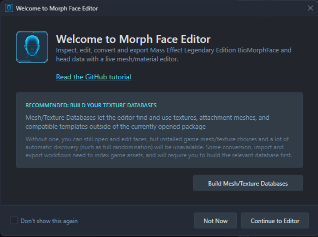
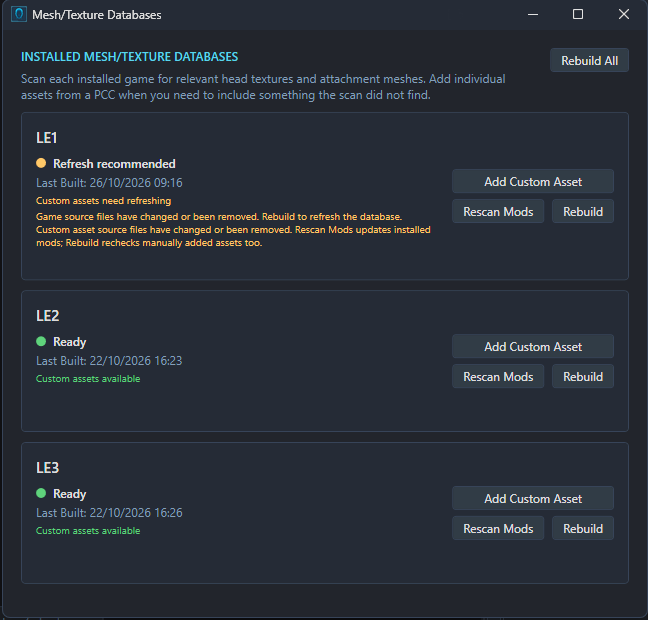
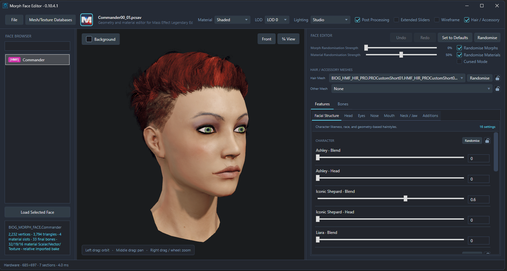

# Getting Started

MFE is a Windows application for Mass Effect Legendary Edition. The editor does not ship any game assets, so you'll need LE installed so its meshes and textures can be found.

1. The MFE 7z (downloaded here on Github or via Nexus) should be extracted into a folder, with its files kept together.
2. The editor is started by opening **MorphFaceEditor.exe**.
3. On the welcome screen, the database window is opened with **Build Mesh/Texture Databases**.
4. The scan is started with **Rebuild** beside the game you'll be working with, or **Rebuild All** for all detected games. Once it's finished, the database window can be closed to reach the editor.

The databases let MFE find the head meshes, textures and hair in your installed games and mods. They aren't changed by the scan. Only the database for the game you're using needs to be built.

This can be skipped with **Not Now**, but some asset choices and workflows won't be available. The window can always be reopened with **Mesh/Texture Databases** at the top of the editor. If mods are added or removed later, **Rescan Mods** can be used to update an existing database.

You can also add custom meshes/textures to the database if it wasn't automatically picked up in the scan.

## Settings

Open **File → Settings** to change the editor's appearance and language.

- Choose a **Language**, then restart MFE for the change to take effect.
- Choose **System**, **Light** or **Dark** under **Theme**. System follows your Windows theme.
- Select the **Accent Colour** swatch to choose a colour for the interface.

## Updates

MFE checks GitHub for a newer release when it starts. If one is available, click **Update Available** in the status bar to open its release page and download it. Updates aren't installed automatically.

## Which files can be opened

Files are opened through **File → Open File**. For most Shepard edits, the PCSAV route is the easiest place to start. Here's a list of file formats MFE supports:

| File | What it can be used for |
| --- | --- |
| **PCSAV** (`.pcsav`) | A LE PC career save. Your Shepard can be edited directly, then saved back into that career file. |
| **TSE / MFE full headmorph** (`.ron`) | A headmorph previously exported from Trilogy Save Editor or Morph Face Editor. It can be edited on its own or imported onto a Shepard in an open save. |
| **MFE Morph / Material headmorph** (`.ron`) | A headmorph previously exported from Morph Face Editor that contains only morph slider info or material info - this can be imported back into a compatible face.     |
| **Gibbed headmorph** (`.me2headmorph`, `.me3headmorph`) | A headmorph previously exported from the legacy ME2/ME3 Gibbed save editors. These can be imported for LE2 and LE3, respectively. |
| **PCC** (`.pcc`) | A game package containing NPC faces. Those faces can be edited and saved directly in the package or exported to another file.     |
| **Custom mesh** (`.gltf`, `.glb`, `.psk`, `.pskx`) | A mesh that can be assigned head materials and previewed with your chosen settings. The result can be exported to PCC, or its material settings exported to a MFE RON. This is an advanced workflow. |

For NPC work, the mod page also has **Global Morphs** packages, with every face from each game collected into one file. These are opened just like any other PCC containing faces.

A new blank face can also be created through **File → New Player Morph** or **File → New NPC Morph**.

## Find your way around

The editor has three main panes:

- **Face Browser**, on the left: the faces available in the open file. In a PCC, a face is selected here and opened with **Load Selected Face**. A PCSAV's head is loaded automatically. Right click on a face to see various options.
- **Live Preview**, in the middle: the face as it currently looks, with camera controls around it.
- **Face Editor**, on the right: the controls used to change its shape and appearance.

The dividers between these areas can be dragged if a bit more room is needed. There are also additional controls at the top-right for material mode, lighting styles, and various other toggles.

## Make a few changes

Most face editing is handled in the **Features** tab. The controls are grouped into sections of the face, with shape, material and texture settings kept together where they're relevant. Morph sliders first, then material scalars, followed by colours and textures.

### Face shape

Sliders can be dragged for a quick adjustment, or a number can be entered for a more precise value. Small changes are a good starting point; the result can be checked from a few angles as you go.

The **Bones** tab is for advanced editing and can be left alone while you're getting familiar with MFE.

### Colours and materials

Colour swatches can be selected to open the colour picker. Other material sliders control things like shine and the strength of particular effects. The available settings depend on the face being edited.

For a first go, something obvious like eye or hair colour is a useful way to get a feel for the controls.

### Textures

The **Textures** sections contain choices for the relevant part of the face. A different texture can change skin detail, makeup or other surface features, depending on the slot. More choices can be found once the game's database has been built, and you can search for the texture itself manually.

### Hair and accessories

Hair and accessory meshes can be changed using the selectors above the Features and Bones tabs. The **Hair / Accessory** checkbox above the preview only controls whether they're shown there; the selected hair isn't removed when it's unticked.

### Undo and randomisation

Changes can be stepped back with **Undo** or **Ctrl+Z**, and restored with **Redo** or **Ctrl+Y**.

With **Randomise**, new combinations of face shapes and materials can be tried. Morph and material randomisation can be enabled separately, and their strengths adjusted. **Cursed Mode** can be enabled when you fancy generating man made horrors beyond our comprehension.

The controls and randomisation category locks are covered in more detail in [Editing Faces](EDITING-FACES.md).

## Check the preview

| Control | Action |
| --- | --- |
| Left mouse drag | Rotate the head. |
| Middle mouse drag | Move the head. |
| Mouse wheel or right mouse drag | Zoom in/out. |
| **Front** or **¾ View** | Snaps the view to a preset. |

The **Lighting** menu can be used to check the face under different conditions. **Studio** (the default) is a useful starting point for judging colours. Other visual options, including **Post Processing** and **Wireframe**, are explained in [Editing Faces](EDITING-FACES.md).

These settings only affect the preview. The game's own lighting and rendering will still affect the final appearance, so a check in game is worthwhile once the edits have been saved.

## Save the result

For an open PCSAV, **File → Save File** (Ctrl+S) writes the edited head back into that save. **File → Save As** (Ctrl+Shift+S) can be used to write a separate copy. This behaviour is the same if you imported a PCC or full headmorph RON.

An exported headmorph is a separate file. For it to appear on Shepard, it still needs to be imported into a save. The steps for direct save editing, RON imports and Gibbed imports are covered in [Player Faces](PLAYER-FACES.md).

[Back to the documentation](../README.md#documentation)
