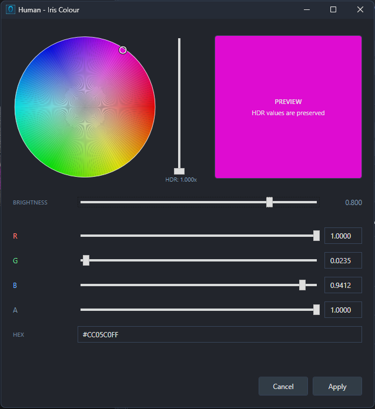
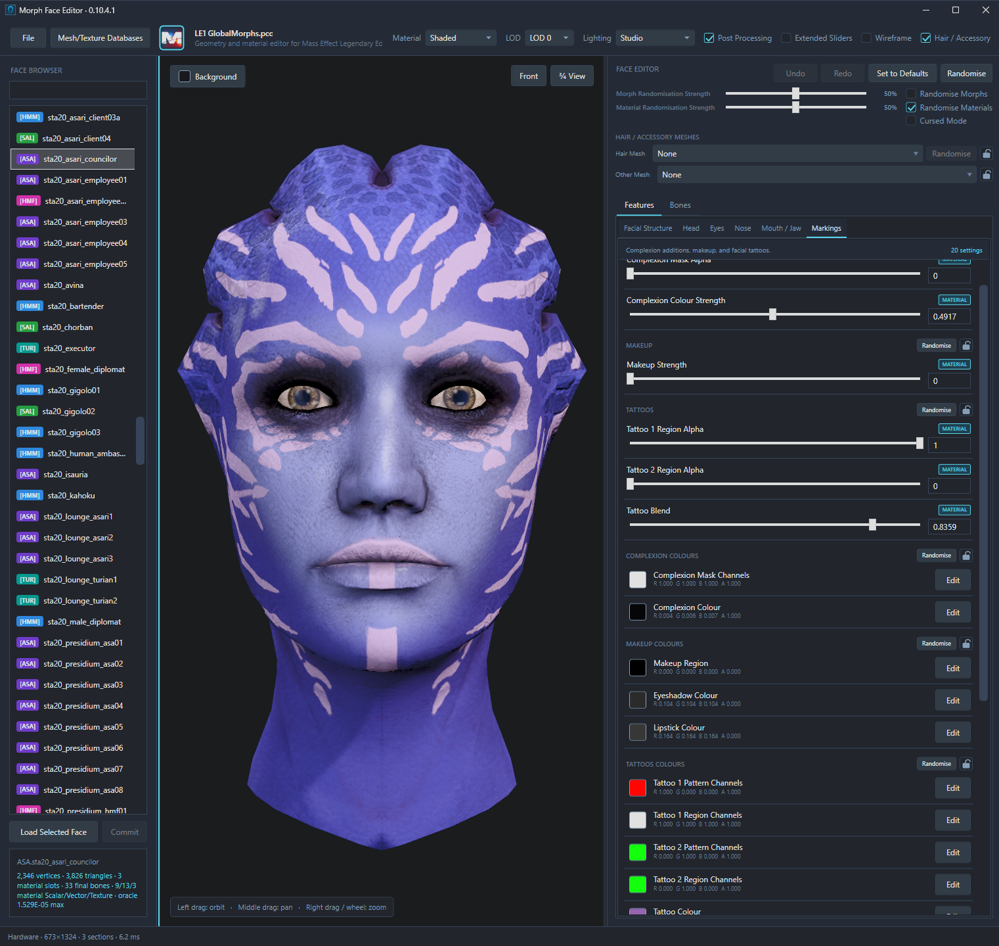
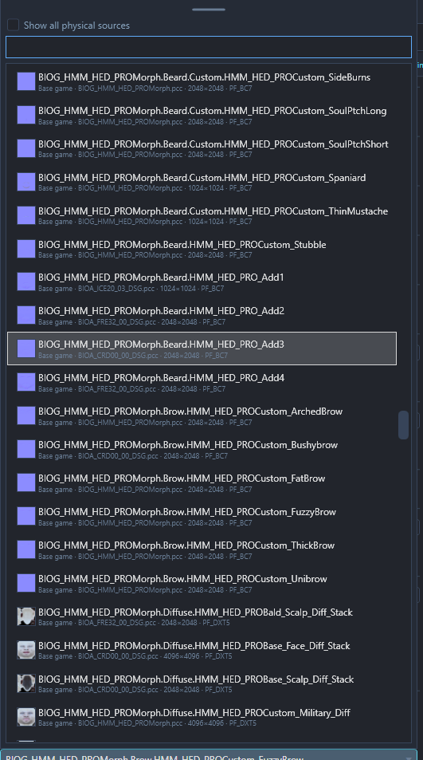

# Materials, Textures and Attachments

Skin tone, makeup, markings, eye colour and shine are all controlled by materials. The way they're put together varies between archetypes, so a colour change that works on a human might need a different approach on an alien face.

The basic controls are covered in [Getting Started](GETTING-STARTED.md). This guide goes into the material setups themselves, how textures are chosen, and how hair and accessories fit into the picture.

## Colours, strengths and textures

Most appearance changes involve some combination of these controls:

| Control | What it does |
| --- | --- |
| Colour | Usually sets a tint, such as skin or lipstick colour. Some colour-style controls select texture channels or regions instead. |
| Strength or blend | Controls how strongly an effect is applied or mixed with another layer. A colour may be barely visible if its strength is low. |
| Texture | Supplies surface detail, a pattern or a mask defining where an effect appears. |

If a new colour appears to do absolutely nothing, its strength and mask are worth checking before the colour picker is blamed. Different faces and games expose different settings; the controls shown are those supported by the current material.

### The colour picker

The picker is opened with **Edit** beside a colour swatch. A colour can be selected with the wheel, adjusted with **BRIGHTNESS** and **HDR Intensity**, or entered through the RGB and HEX fields. **Apply** keeps the change and **Cancel** restores the previous value.

HDR intensity allows colours brighter than the normal display range, which can have a strong effect on highlights or glow. HEX is useful for ordinary colours, but doesn't represent the full HDR value. The **A** channel also has different jobs in different parameters; it shouldn't automatically be treated as transparency.

The **Lighting** presets are useful for checking changes. A colour judged only under Studio lighting can be quite surprisingly different when it's viewed under **Cinematic or Warm Interior**.

## How the archetypes work

### Human Male and Female

**Skin Tone** is the starting point for overall skin colour. **Skin Light Scattering**, transmission and specular controls affect its response to light, so those can be adjusted separately once the base colour looks right.

The **Face Diffuse Texture** supplies the underlying appearance. **Face Normal Texture**, secondary normals and **Normal Blend** affect the surface detail seen under lighting. Skin tone alone won't replace the features painted into those textures.

On Human Female materials, makeup colours are paired with controls such as **Eyeshadow Strength**, **Eyeliner Strength**, **Lipstick Strength** and **Blush Strength**. Their placement is defined by the **Makeup Mask Texture**. For a different lipstick look, for example, the lip tint colour and lipstick strength can be adjusted first; a different makeup mask is needed if the placement itself should change - and the vanilla game only includes one.

Brows and other facial additions have their own colours, strengths and textures. **Brow Texture** is a Player-material option, so the same control won't necessarily be offered on an NPC face. Player/NPC materials and the different games have slightly different setups. On NPCs, Brows/Beards are combined into one texture but on Players they are applied individually with their own seperate parameters.

**Iris Colour**, **Sclera Colour** and **Eyelash Colour / Opacity** are separate from the skin and makeup. Hair colour is separate again, with the scalp pairing covered under [Hair and accessories](#hair-and-accessories).

**Important Note** In LE2/LE3, the Renegade Scar system applies unique Emissive textures to the eye which uses an alpha channel the normal NPC Eye Diffuse does not have. If you use an NPC eye diffuse on a Player head, the entire eye will glow red.

### Asari

Asari share an eye material with Human Female, so the same settings will apply to both. Alongside the main skin colour, **Secondary Skin Colour** can be mixed in with **Secondary Skin Blend**. Complexion, makeup and tattoos are grouped under **Markings**.

**Makeup Texture** defines the makeup placement, with **Eyeshadow Colour**, **Lipstick Colour**, **Makeup Strength** and **Makeup Region** controlling the result. The tattoo layers use the pattern and region controls described below.

### Salarian

**Skin Tone**, **Secondary Skin Colour** and **Secondary Skin Blend** control the base colours. Extra complexion detail can be changed with **Complexion Texture**, **Complexion Colour**, **Complexion Strength** and its mask controls.

The **Surface Tint Mask** and **Complexion and Tattoo Mask** define the areas those effects can use. For markings, the texture, selected region and tint all need to work together. **Iris Colour**, **Pupil Colour** and **Eye Emissive Strength** are available for the eyes.

### Turian

The main skin colour and secondary skin blend are joined by **Bone Plate Tint** and **Eye Socket Tint**. Complexion settings and the two tattoo layers are found under **Markings**. Male and Female Turians (the latter of which is used by Diversification Project) use the same material-control layout.

The **Face Region Mask** defines regions around the brows/forehead, middle face and jaw/mandibles. **Surface Tint Mask** is involved in the skin, teeth and eye-socket colour regions. If only part of a colour change is showing, the selected region and mask are worth checking.

### Tattoo/Complexion layers on Alien Faces

These archetypes share a two-layer tattoo setup as well as a Complexion. Each layer has pattern-channel and region-channel controls, with one shared **Tattoo Colour** setting the tint for both layers.

1. The **Tattoo Texture** (**Tattoo Pattern Texture** on Salarians) is chosen for the pattern options it contains.
2. **Tattoo 1 Pattern Channels** is adjusted to select or mix patterns from that texture. For example setting this to pure Green will select the green channel of the texture. White would use all three channels.
3. **Tattoo 1 Region Channels** is adjusted to control which region of the face the tattoo pattern appears, using the mask texture. The alpha is controlled by a seperate material slider. See below for more information on what the regions tint on each species.
4. **Tattoo/Complexion Colour** is adjusted for the visible tint.
5. The second layer can then be set up through the corresponding **Tattoo 2** controls. This allows you to combine two different tattoos for different sections of the face in creative ways - but they always share the same colour.
6. The complexion mask channels use the same region channels as the tattoos.

The channel controls are selectors or weights, rather than ordinary colour tints. A red-looking selector doesn't necessarily mean a red tattoo. One channel can be changed at a time to see which part of the pattern or face it affects; different textures can contain different patterns and regions.

**Region Channel Tips**

| Archetype | Red | Green | Blue | Alpha |
| --- | --- | --- | --- | --- |
| Asari | Upper Face | Inner Cheeks / Chin / Jaw | Forehead / Scalp / Outer Cheeks / Neck | Sides & Back of the Neck |
| Salarian | Eyes / Brow / Cranium | Under Eyes / Cheeks | Mouth / Chin / Neck | Back of the Neck & Head |
| Turian | Brows / Forehead | Cheeks / Nose | Jaw / Mandibles | Head Spikes |
| Krogan (Complexion Only) | Eyes / Brows / Nose | Cheeks / Mouth / Chin | Neck | — |
| Batarian (Complexion Only) | Brows / Forehead | Chin / Neck | Cranium / Back of the Head | — |

Vorcha also use tattoos but do not use a region mask and only a single tattoo layer.

### Krogan

Regional colours are controlled with paired colour and strength settings: **Face Gradient** under **Head**, **Head Plate Gradient** under **Facial Structure → Head Plates**, and **Lip Gradient** under **Mouth / Jaw**. The **Gradient Selector** texture controls their affected areas.

A colour and its corresponding strength should be adjusted together when changing a gradient. **Wrex Spec Strength** is intended for Wrex's unique specular texture, so it isn't a general-purpose shine control for every Krogan.

### Batarian

**Regional Colour** under **Facial Structure** contains paired **Face**, **Neck** and **Top Head Gradient** colours and strengths. The **Gradient Selector** texture determines where those colours are applied.

A new gradient colour won't change a region that's excluded by its selector texture.

### Vorcha

**Muzzle Colour**, **Secondary Muzzle Colour** and **Teeth / Bone Colour** control different parts of the head. Their areas are defined by the **Region Mask**.

**Iris Colour** and, where available, **Eye Glow Colour / Intensity** control the eyes. Vorcha appearance changes are handled through these material controls; morph sliders aren't available.

## Choosing textures

The texture's role matters as much as its name:

| Texture type | What to expect |
| --- | --- |
| Diffuse | The main surface colours and painted detail. |
| Normal / Complexion / Addition    | Surface detail that reacts to light, without changing the mesh's shape. |
| Specular | The strength or character of reflections and highlights. |
| Mask / Tint | Regions or channels used by colours, patterns and other effects. These can look quite odd as ordinary images. |

Some textures pack several kinds of information into different channels. A diffuse, normal and mask from unrelated setups may therefore produce a very different result from the one expected. Texture randomisation uses eligible paired families; manually choosing a texture shouldn't be assumed to replace all of its partners too. I highly recommend relying on Randomisation unless you're very familiar with what these textures do and how to find them.

### Using the texture picker

The dropdown can be searched by texture name, full path, source package or origin. Thumbnails are shown in the list, with a larger preview and source information on hover.

Hovering over a choice temporarily previews it on the face. Clicking it or pressing **Enter** keeps the selection; **Escape** or closing the picker cancels the temporary preview. The list can also be resized if more room is needed by expanding the Face Editor pane.

The **Show all physical sources** checkbox reveals every instance of a texture's path in the game, including installed, manually added and open-package sources. It's useful when the same texture exists in several places, such as a vanilla copy and a modded one. But you typically shouldn't need to use this, as every instance of a texture under a unique path *should* be identical.

Player workspaces only offer assets that can be loaded for Shepard, since player morphs can only use assets that are seekfree (as in stored in a BIOG package or Startup file such as SFXGame, BIOC_Materials etc). NPC/package workspaces have a broader selection, so the lists can differ even with the same database.

### Adding a missing texture or mesh

Installed mods can be refreshed through **Mesh/Texture Databases → Rescan Mods**. A specific asset can also be added manually:

1. Open **Mesh/Texture Databases**, then **Add Custom Asset** beside the relevant game.
2. Choose the PCC containing the asset you want
3. Tick the **Texture2D** and/or **SkeletalMesh** entries you wish to add to the database.
4. **Confirm** the selection.

This adds game assets from a PCC. Loose DDS or PNG images can't be imported through the texture picker; a custom texture needs to be available as a Texture2D in a PCC first. Adding an asset to the database also doesn't make an NPC-only asset usable by Shepard unless it is in a BIOG or Startup package. For reference, all hair mods use BIOG startup packages (such as BIOG_HMM_HIR_HALCYON.pcc)

## Hair and accessories

The selectors above the Features and Bones tabs change the face's hair and accessory mesh references. They can be searched by name, path or source package, with temporary previews on hover. The choice is kept with a click or **Enter**, and cancelled with **Escape**. **None** removes the selected attachment from the slot.

The **Hair / Accessory** checkbox above the preview only shows or hides the attachment there. It doesn't remove the selected hair from the saved face.

### Hair and scalp matching

The visible hair mesh and the scalp texture aren't always independent. Some styles (such as Braids or Mohawk) are intended to be used with particular scalp textures, so MFE may offer **Match Scalp Textures** when the hair is changed.

**Yes** applies the matching textures, and sometimes switches the head to use the Player scalp material if needed. **No** keeps the current scalp setup. The prompt is only shown where a pairing is available; every hairstyle isn't automatically given a new scalp.

**Hair Colour** changes the tint, while scalp controls affect the part drawn onto the head. A mismatch can leave a painted hairline or scalp detail showing beneath a new style.

### Saving attachments

For NPCs, hair and accessory changes are applied to the actor through **Assign Materials to Actor**, then the PCC is saved. Existing components are updated; new hair/accessory mesh components aren't created. The steps are covered in [NPC Faces and Actor Assignment](NPC-FACES.md).

In a [Custom Mesh Workspace](CUSTOM-MESHES.md), attachments are preview only and aren't included in the mesh PCC export. A MFE material RON can retain references for preview.

## Reuse a material setup

For a compatible face in the same game and archetype, **Copy Material Data** and **Paste Material Data** are available in the face's right-click menu. They transfer material values and textures, with the destination's attachment selections kept.

**Export Materials** saves an MFE material RON for later use, and **Import Materials** applies one to a compatible face. These presets can also include hair/accessory references where supported, so the result should be checked after import. In a Custom Mesh Workspace, the slot assignments are kept and only settings supported by the assigned materials are applied.

Human material settings can also be transferred through **Import TSE RON** and **Export TSE RON**. These actions handle material data; a full exported headmorph is brought in through **Import Morph Face** instead.

Material changes still need to be saved through the relevant workflow: directly into a [Player save](PLAYER-FACES.md), applied to the [NPC actor](NPC-FACES.md) and saved, or exported from the [Custom Mesh Workspace](CUSTOM-MESHES.md).

[Back to the documentation](../README.md#documentation)
