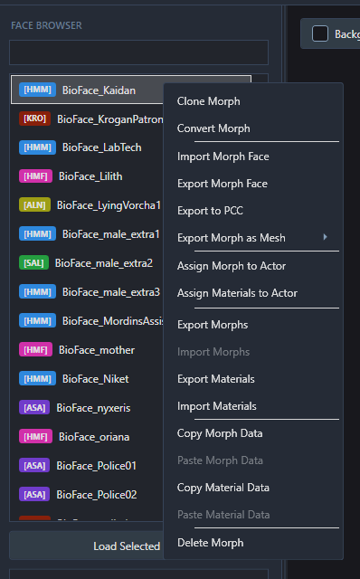
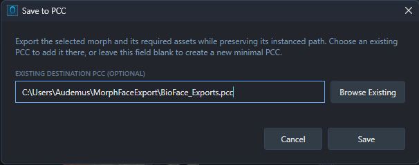
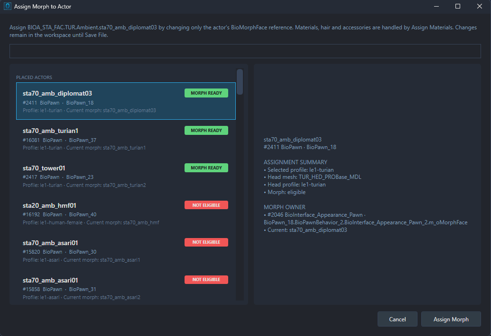
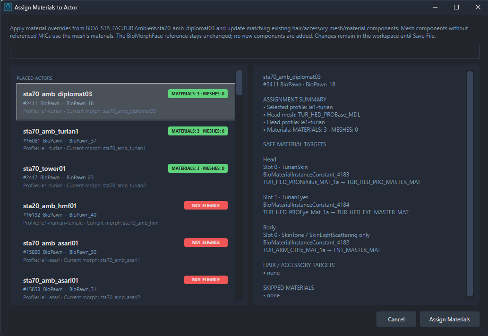

# NPC Faces and Actor Assignment

NPC faces can be edited directly in PCC files, or a new face can be created and added to the package where it's needed. This is an intermediate workflow for mod developers; the normal editing controls are covered in [Editing Faces](EDITING-FACES.md).

There are two parts to an NPC's appearance: the BioMorphFace being used, and the BioMaterialOverride materials, hair and accessories assigned to the actor. Both can be handled in MFE, but they're applied separately.

## Open an existing NPC face

1. The PCC containing the face is opened through **File → Open File** (Ctrl+O), or dragged onto the window.
2. The face can be found in the **Face Browser** on the left. The search box can be used to filter by name, path or archetype tag, such as `[HMM]`.
3. The face is opened with **Load Selected Face**, or by double-clicking it / pretting Enter.
4. Shape, material, texture and hair changes can then be made using the controls on the right.

If the actor already uses this BioMorphFace, its morph assignment can be left as it is. Material and hair changes need to be applied through **Assign Materials to Actor**, covered below, before the PCC is saved.

### Global Morphs packages

The mod page includes **Global Morphs** packages, with every face from each game collected into one file, including every face ported in every direction (eg. all LE3 faces in LE1, all LE2 faces in LE3 etc). These are useful for finding a starting point without digging through half the game's PCCs.

They're opened in the same way as any other PCC. Once a face has been edited, it can be exported into the package containing the NPC you want to change. Saving the Global Morphs package alone won't update that NPC's own package.

### Keep a shared face separate

The same BioMorphFace can be used by more than one actor. If only one of them should be changed, an independent copy can be made with **Clone Morph** in the face's right-click menu. The copy can then be edited and assigned to the intended actor.

### Delete an NPC face

Right-click the face and choose **Delete Morph**, then confirm. This deletes the BioMorphFace and its child exports from the working package. If other entries reference the face, MFE warns that those references will be broken. Check those references before proceeding; use **Clone Morph** and actor assignment when you want an independent face for one actor instead.

The deletion isn't written to the PCC until you choose **File → Save File**.

## Create a new NPC face

1. A new face is started through **File → New NPC Morph**.
2. The game and archetype are selected, then a name is entered for the face.
3. The face will be opened for editing. Once it's ready, it can be added to a PCC using **Export to PCC** in its right-click menu.

The game's **Mesh/Texture Database** should be built first. The available archetypes depend on suitable assets being installed; setup is covered in [Getting Started](GETTING-STARTED.md).

**Female Turian [TUF]** appears in the chooser when a compatible face donor is installed for that game and its database has been built. Compatible female Turian faces support morph editing. Some older faces have incompatible baked geometry: MFE preserves that data and offers material editing only.

## Exporting the face to PCC

Actor assignment works on faces and actors in the **same open PCC**. If a face was created separately, taken from Global Morphs or edited in another package, it needs to be added to the actor's package first.

1. **Export to PCC** is selected from the face's right-click menu.
2. In **Save to PCC**, **Browse Existing** is used to select the PCC containing the target actor.
3. The export is completed with **Save**. The face and its required assets will be added to that package.
4. The destination PCC is then opened through **File → Open File**, and the exported face selected in the Face Browser. Exporting doesn't automatically switch to the destination package.

The currently open source PCC can't also be chosen as the export destination. Changes to a face already in that PCC are kept with **Save File** instead.

If the destination field is left blank, **Save** offers a new PCC for the face and its assets. That's useful for a standalone face package; assignment still needs to be carried out in a PCC containing the target actor.

## Assign the face to an actor

The two assignment options are found by right-clicking the face in the Face Browser:

| Option | What's applied |
| --- | --- |
| **Assign Morph to Actor** | The actor is pointed at the selected BioMorphFace. Its material, hair and accessory assignments are handled separately. |
| **Assign Materials to Actor** | The face's BioMaterialOverride settings are applied, along with compatible hair/accessory mesh and material changes, to the actor's MaterialInstanceConstants. The actor's BioMorphFace assignment is kept. |

For a complete face replacement, both actions will usually be needed. If only the materials are being changed on an already assigned face, **Assign Materials to Actor** can be used on its own.

### Choose the target

1. The face to be applied is selected, then **Assign Morph to Actor** is chosen from its right-click menu.
2. In the assignment window, the target can be found with the search box or the list on the left.
3. An eligible target is selected and its details checked on the right, including any warnings.
4. The assignment is confirmed with **Assign Morph**.
5. For materials and attachments too, the process is repeated through **Assign Materials to Actor**, with the same target selected and **Assign Materials** pressed.

One target is assigned at a time. The list is split into two groups:

- **PLACED ACTORS** are individual actors in the package's PersistentLevel.
- **SPAWN TEMPLATES / ACTOR TYPES** are templates used to create actors. A change here can affect several NPCs spawned or inherited from that type, so the intended target should be checked carefully.

Targets marked **NOT ELIGIBLE** can't be assigned through that operation. The details pane explains why; some targets can support morph assignment but have unresolved material or attachment targets.

### Materials and attachments

Material assignment updates the actor's existing setup. Compatible hair and accessory components can be updated, but new hair or accessory mesh components aren't added. An existing attachment may also be cleared if the source face has no corresponding hair or accessory. The proposed changes and any unresolved targets can be checked in the chooser, with a report shown after material assignment.

For body materials, only **SkinTone** and **SkinLightScattering** values are applied where available. Other body material settings are kept.

## Save the PCC

Actor assignments are kept in MFE until **File → Save File** (Ctrl+S) is used. **File → Save As** (Ctrl+Shift+S) can be used to write a separate copy. A successful assignment message isn't a disk save, so this last step still needs to be done.

The saved PCC can then be used in your mod and checked in game. If the wrong appearance is being displayed, the actor's morph assignment and material assignment are both worth checking, along with whether the edited PCC is the one being loaded by the game.

## Use an exported NPC headmorph

A NPC RON previously exported by MFE can be opened through **File → Open File** (Ctrl+O) or dragged into MFE and edited on its own. It can then be exported to the actor's PCC using the steps above.

An existing face in an open PCC can also be replaced with **Import Morph Face / Morphs / Materials** in its right-click menu. A NPC RON exported by MFE for the same game and archetype is needed. The imported face can then be assigned as required and the PCC saved.

[Back to the documentation](../README.md#documentation)
