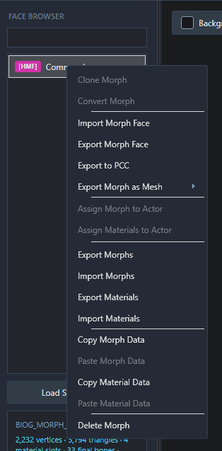

# Player Faces

Your Shepard's appearance can be edited and saved back to your Legendary Edition save (`.pcsav`) file, with the result previewed as you work. A headmorph you've exported yourself or downloaded can also be imported, or a new blank player morph can be created for standalone export.

For setup and a tour of the editor, see [Getting Started](GETTING-STARTED.md).

## Edit Shepard in a career save

1. In Morph Face Editor, the destination `.pcsav` is opened through **File → Open File** (or by dragging it onto the window)
2. Your custom Shepard's headmorph will be loaded into the face list and preview. If the save has no custom headmorph because you're playing as default Sheploo or FemShep, you'll be offered a new default one to edit. It won't be added to the savegame until your changes are saved.
3. Changes can be made using the controls on the right, with the result shown in the preview as you work.
4. The edited headmorph is written into the career save with **File → Save File** (Ctrl+S). A separate copy can be written with **File → Save As** (Ctrl+Shift+S) and a new destination.
5. The saved career can then be loaded in the game to check the result. In-game lighting and animation can look different from the editor preview, but it is a very close approximation.

### Making changes

The **Features** tab groups the controls for the face. Morph sliders can be used to adjust its shape, while material sliders, colours and textures can be changed in the relevant categories. The available controls depend on the face being edited.

Hair and accessories can be selected using the mesh controls above the tabs. The **Hair / Accessory** checkbox above the preview shows or hides them in the preview; it doesn't remove them from the face. If a saved hair or accessory mesh can't be previewed, you'll get an error message but the reference will still be saved to the headmorph on export unless you change it.

A few small adjustments are a good starting point, and anything you're unhappy with can be taken back with **Undo** (Ctrl+Z). The **Bones** tab is for more advanced editing and isn't needed for the steps in this guide. The everyday controls and preview settings are covered in [Editing Faces](EDITING-FACES.md).

### Restore the default Shepard head

To remove a custom head from a career save, right-click Shepard's face and choose **Delete Morph**, then confirm. This immediately saves the currently open PCSAV and closes the workspace. The game will use the default Shepard head instead.

If you'd like a backup first, use **Save As** to make a separate copy, then reopen the save you want to change before deleting the morph.

## Use an existing headmorph

An exported headmorph can be used as a starting point, whether it came from your own save or was downloaded elsewhere. Trilogy Save Editor (TSE) exports full headmorphs as `.ron` files. Gibbed exports from the original Mass Effect 2 and 3 use `.me2headmorph` and `.me3headmorph`, respectively.

### Apply a RON to a career save

The headmorph should be for the same game and Shepard gender as the destination savegame.

1. The destination `.pcsav` is opened as described above. If it has no headmorph, a new one can be created when offered.
2. **Import Morph Face** is selected from the right-click menu on Shepard's face in the list, then the full headmorph `.ron` file is chosen.
3. The result can be checked in the preview and any further changes made.
4. The change is written into the career save with **File → Save File** (Ctrl+S), or into a separate save with **Save As** (Ctrl+Shift+S). That save can then be loaded in game to check it.

### Open a headmorph on its own

The headmorph can be opened through **File → Open File** (Ctrl+O). When prompted, the matching LE game is selected (unless it's a LE1/LE2 RON, in which case you may be asked to specify which game workspace to use). Files exported by MFE may already contain the game information, so those prompts can vary based on if it's a TSE or MFE file. On import the imported face is given a name.

For a Gibbed file, **LE2** is selected for `.me2headmorph` or **LE3** for `.me3headmorph`. This brings your old original-trilogy headmorph into LE2/LE3.

Once opened, the face can be edited in the same way as a career head. A full `.ron` can then be saved with **Export Morph Face** in the face's right-click menu and applied using [Apply a RON to a career save](#apply-a-ron-to-a-career-save). The exported RON can also be imported into a save using Trilogy Save Editor. This is also a good way to convert a ME2 gibbed headmorph into a LE1 compatible morph.

An opened full RON can be saved back to its source with **Save File**, or written to a separate RON with **Save As**. Exporting a RON creates a separate headmorph file; it doesn't change a career save by itself.

## Create a new player face

A new face is started through **File → New Player Morph**. Once the game and gender have been selected and a name entered, a face based on the game's player defaults will be opened for editing.

When it's ready, a RON can be created with **Export Morph Face** in the face's right-click menu. It can then be applied to a career save using the steps above, or imported into a save with TSE. You do not need to use TSE anymore for headmorphs, however so this is more of a legacy option.

[Back to the documentation](../README.md#documentation)
