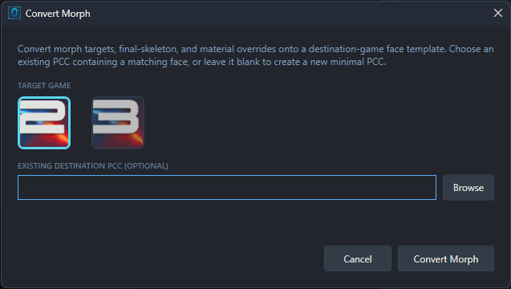
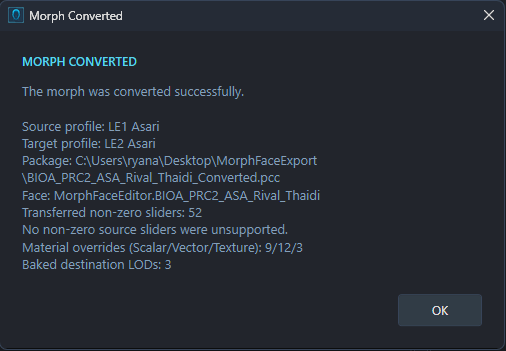

# Saving, Exporting and Conversion

Use **Save File** to keep changes in the file you're editing, or choose an export option to create a separate headmorph, preset, mesh or PCC. The right option depends on what you want to keep and where you want to use it.

## Save the file you're editing

Choose **File → Save File** (Ctrl+S) to update the current file:

- **PCSAV:** save your Shepard's edited head back into the career save.
- **PCC:** save the package's changes, including edited faces and actor assignments.
- **RON:** save back to the type of RON you opened. A full headmorph stays a full headmorph; a material preset still saves only material data.

Choose **File → Save As** (Ctrl+Shift+S) to save a separate copy in the same format. After that, **Save File** updates the new copy. Save As doesn't convert between formats; use the export options for that.

For a PCC, **Commit** keeps the currently loaded face's edits in the working package without saving the source file. **Save File** writes the package to disk, including those edits; you don't need to press **Commit** first.

For a new standalone face or an imported Gibbed headmorph, **Save File** opens the PCC export workflow. You can also right-click the face and choose a RON export instead. MFE imports Gibbed files but doesn't write changes back as `.me2headmorph` or `.me3headmorph`.

For an imported mesh, **Save File** offers **Export to PCC** or **Export Materials to RON**. If you've imported several faces into one standalone workspace, right-click each face and export it separately.

## Choose what to export

Right-click the face in the **Face Browser** to find these options:

| Option | Format | What it includes |
| --- | --- | --- |
| **Export Morph Face** | Full headmorph RON | Morph sliders, bones, baked face geometry, material settings and hair/accessory references. |
| **Export Morphs** | Morph-only RON | Morph slider values. It doesn't include bone edits, materials or attachments. |
| **Export Materials** | Material-only MFE RON | Material values, texture references and supported hair/accessory references. It doesn't include the face shape. |
| **Export to PCC** | PCC | The face and its required package assets. Custom Mesh workspaces export the mesh and its materials instead. |
| **Export Morph as Mesh → PSK / glTF** | Mesh files | The face mesh for use in a modelling tool, with an accompanying MFE sidecar file for reimport. |

RON files reference textures and attachment meshes rather than bundling those assets. If a head or preset uses modded hair or textures and you plan to share it with others, let people know which mods they need.

An export writes a separate output. It doesn't also save your changes back into the original PCSAV or PCC, so use **Save File** (Ctrl+S) if you want to update the source.

## Export a full head or a preset

1. Select the face you want to export in the Face Browser.
2. Right-click it and choose **Export Morph Face**, **Export Morphs** or **Export Materials**.
3. Choose a filename and click **Save**.

Use **Export Morph Face** when you want to keep the complete head, including bone edits. To put it onto Shepard, open the destination PCSAV, right-click the career head and choose **Import Morph Face**, then save the career. See [Player Faces](PLAYER-FACES.md) for the full walkthrough.

Use **Export Morphs** to transfer slider values while keeping the destination's materials and attachments. Apply it through **Import Morphs** on a compatible face. This is a slider preset, so use a full head export if the appearance also depends on bone edits or authored geometry.

Use **Export Materials** for an appearance preset. Apply it through **Import Materials** on a compatible face. For the picker, scalp pairings and preset behaviour, see [Materials, Textures and Attachments](MATERIALS-TEXTURES-AND-ATTACHMENTS.md).

In a **Custom Mesh Workspace**, **Import TSE RON** and **Export TSE RON** provide Human material presets. These contain material data rather than a full headmorph. See [Custom Meshes](CUSTOM-MESHES.md) for the supported material combinations.

### Why some edits can still show as unsaved

If you open a material-only RON and also change the face shape, **Save File** saves the materials to that RON. The shape changes still need another output. The same applies to non-slider edits made while working from a morph-only RON.

Choose **Export Morph Face** or **Export to PCC** to keep the whole head. A successful preset save only covers the data that preset can hold.

## Copy shape between faces

To transfer shape data without creating a preset file:

1. Right-click the source face and choose **Copy Morph Data**.
2. Open the destination PCC if needed, then right-click its face and choose **Paste Morph Data**.
3. Check the result and choose **File → Save File** to keep it in the PCC.

The source and destination must match in game and archetype, and the destination must be an editable package face. This transfers morph sliders, final bone positions and baked face geometry, while leaving materials and attachments alone. Unlike **Export Morphs**, it isn't limited to slider values. Morph copy and paste aren't available for Vorcha; copying also requires compatible female Turian geometry.

## Export a face to PCC

Use this to move a face into another package or create a standalone face package.

1. Right-click the face and choose **Export to PCC**.
2. To add it to an existing package, click **Browse Existing** and choose the destination PCC. To create a new package, leave the destination field blank.
3. Click **Save**. If you're creating a new PCC, choose a new filename when prompted.
4. Open the destination PCC yourself when you want to inspect or assign the exported face. Exporting doesn't switch the current file.

The export keeps the face's instanced path and includes its required assets. It doesn't assign that face to an actor. For that, follow [NPC Faces and Actor Assignment](NPC-FACES.md).

To update the PCC you're already editing, use **Save File**. You can't also choose that same source PCC as the export destination.

### Custom mesh PCC exports

Custom Mesh workspaces use a different PCC export: **Save Mesh and Materials to PCC** creates a new mesh-and-material package. If you choose an existing filename, it offers to overwrite that file rather than add to it. Assign every used material slot before exporting, and follow [Custom Meshes](CUSTOM-MESHES.md) for the details.

## Export a mesh for external editing

1. Right-click a supported face and choose **Export Morph as Mesh → PSK** or **glTF**.
2. Choose an output folder and complete the export.
3. Keep the accompanying `.mfe.json` file beside the mesh if you plan to bring it back into MFE. Keep any glTF `.bin` files with it too.

The sidecar holds head information that the mesh file alone can't preserve. Its name follows the mesh filename: for example, `MyHead.gltf` has `MyHead.gltf.mfe.json` beside it. Keep those names paired if you move or rename the files.

Mesh export requires UModel. If MFE reports that it's missing, export a mesh through Legendary Explorer once to let it install the supported UModel build, then try again. I haven't set up MFE to install UModel independantly since any PCC exports require you to use LEX anyway.

Use a full headmorph RON or PCC as well if you want to keep the complete face setup. An external mesh export isn't a replacement for the head's material and attachment data. Custom Mesh workspaces offer PCC and material RON output instead of this **Export Morph as Mesh** menu.

## Convert a face to another game

**Convert Morph** transfers a supported face between LE1, LE2 and LE3. It keeps the archetype, so a Salarian stays a Salarian. Vorcha don't support morph conversion.

This is particularly useful for converting a LE1/LE2 face to LE3 and vice-versa, since LE3 uses a morph system that is incompatible with the earlier games. Note that for humans there's a small handful of morph sliders that do not exist in previous games. For example the human male "Jacob" slider does not exist in LE1, so it will not be used when converting a face into LE1.

Start from an open PCC. If you're working on a standalone RON, Gibbed headmorph or PCSAV head, export the face to a new PCC and open that PCC first.

1. Build the **Mesh/Texture Databases** for both the source and target games if you haven't already.
2. Open the source PCC and select the face you want to convert.
3. Right-click it and choose **Convert Morph**.
4. Choose the **TARGET GAME**.
5. For an existing destination, click **Browse** and choose a PCC from that game containing an editable face of the same archetype. To create a new PCC, leave the destination field blank; MFE finds a suitable installed face to use as a template.
6. Click **Convert Morph**. If you're creating a new PCC, choose a new filename when prompted.
7. Read the conversion report, then open the output PCC to inspect the result.

Conversion writes the output PCC directly. It adds a converted face to an existing destination rather than changing an actor's assignment, and it doesn't switch the editor to that destination. Choose a different file from the source PCC.

### Check the result

As I mentioned above, while they're actually relatively consistent, the games don't all use the exact same sliders, materials or assets - particularly for human morphs. Check the export report for unsupported sliders, texture or attachment warnings, and any note about source geometry that couldn't fully transfer. Unsupported non-zero sliders reset to neutral in the converted face.

Inspect the converted face under a few lighting presets and check it in game. For an NPC, assign the converted face and materials to the target actor. For Shepard, export the converted Human head as a full RON, then import it into a matching career save through [Player Faces](PLAYER-FACES.md).

[Back to the documentation](../README.md#documentation)
