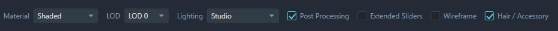
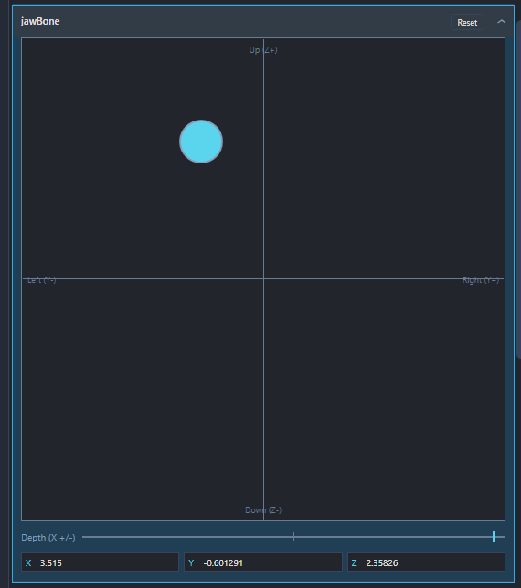

# Shortcuts and Gestures

Use this as a quick reference while editing. The same keys can do different things depending on where you're working, particularly **Enter**, **Escape** and the scroll wheel.

## Keyboard shortcuts

| Shortcut | Action |
| --- | --- |
| **Ctrl+E** | Create a **New Player Morph**. |
| **Ctrl+N** | Create a **New NPC Morph**. |
| **Ctrl+O** | **Open File**. |
| **Ctrl+S** | **Save File**. |
| **Ctrl+Shift+S** | **Save As**. |
| **Ctrl+Z** | Undo the latest face edit. |
| **Ctrl+Y** | Redo an undone face edit. |
| **Ctrl+W** | Close the current file. |

When you're typing in a text field, **Ctrl+Z / Ctrl+Y** work on that text instead. Finish a numeric entry with **Enter**, or click the preview, before using the shortcuts on the face.

Save behaviour depends on what you've opened. See [Saving, Exporting and Conversion](SAVING-EXPORTING-AND-CONVERSION.md) if you need to choose between saving the source, exporting a headmorph or creating a PCC.

You can also drag one supported file onto the MFE window to open or import it.

## Face Browser

| Control | Action |
| --- | --- |
| Click a face | Select it in the list. |
| Double-click a face | Load it into the editor. |
| Up/Down Arrow Keys | Navigate up/down the face list |
| **Enter** (with the face focused) | Load the selected face. |
| Right-click a face | Open its actions, including export, copy/paste and actor assignment where available. |
| Type in the search box | Filter by face name, path or archetype tag, such as `[HMM]`. |

Selecting a face and loading it are separate actions. Use a double-click, **Enter** or **Load Selected Face** when you want to edit it.

## Live Preview

Keep the pointer over the preview for these mouse controls:

| Control | Action |
| --- | --- |
| Left-drag | Rotate the head. |
| Middle-drag | Pan the view. |
| Right-drag up/down | Zoom in or out. |
| Mouse wheel | Zoom in or out. |
| Click **Front** | Return to the front view. |
| Click **¾ View** | Return to the three-quarter view. |
| Click **Background** | Change the preview background colour. |

Use **Lighting**, **Material**, **LOD**, **Post Processing** and **Wireframe** above the preview to inspect the face. Toggle **Hair / Accessory** to show or hide attachments in the preview; it doesn't remove them from the saved head.

## Sliders and number boxes

These controls apply to the Face Editor's morph, material and bone number boxes:

| Control | Action |
| --- | --- |
| Drag a slider | Adjust the value and watch the preview update. |
| Click a number box and type | Enter a precise value. |
| **Enter** in a number box | Apply the typed value and leave the field. |
| **Escape** in a number box | Cancel the pending typed entry and leave the field. |
|  Scroll wheel over a number box | Increase or decrease the value in steps of **0.1**. |
| **Ctrl + Scroll wheel** over a number box | Increase or decrease the value in steps of **1**. |
| **Shift + Scroll wheel** over a number box | Increase or decrease the value in steps of **10**. |

Click **Undo** or **Redo** above the Features tab, or use **Ctrl+Z / Ctrl+Y** outside a text field, to step through face edits. A slider drag counts as one edit, so you don't need to undo every tiny movement. Escape cancels a pending typed entry; it doesn't reverse a slider or wheel change that you've already made.

Use **Extended Sliders** if you want negative values in the slider range, or type/scroll to reach a negative value directly. See [Editing Faces](EDITING-FACES.md) for the advanced controls.

## Texture and mesh pickers

Open a texture, hair or accessory dropdown to use these controls:

| Control | Action |
| --- | --- |
| Type in the search box | Filter the choices. |
| Hover over a choice | Temporarily preview it on the face. |
| **Up / Down** with the dropdown selected | Move through choices and preview them. |
| Click a choice or press **Enter** | Keep the highlighted choice and close the list. |
| **Escape**, or click outside the list | Cancel the temporary preview and keep the previous selection. |
| Scroll wheel over the open list | Scroll through the choices. |
| Drag the list's resize handle | Change the list's height. |

When the picker is closed but has keyboard focus, **Up / Down** or the mouse wheel changes the selection directly. You don't need to open the list or press Enter for those changes.

For texture sources, manual assets and scalp pairings, see [Materials, Textures and Attachments](MATERIALS-TEXTURES-AND-ATTACHMENTS.md).

## Colour picker

Click **Edit** beside a colour to open the picker. Use the wheel and sliders for adjustments, or enter numbers for a precise match.

| Control | Action |
| --- | --- |
| **Enter** in the HEX field | Apply the HEX entry inside the picker. |
| **Escape** in the HEX field | Discard the pending HEX text and restore the current colour's HEX value. |
| Click **Apply** | Keep the colour and close the picker. |
| Click **Cancel** | Restore the colour from before you opened the picker. |

## Bone controls

Use these in the **Bones** tab when bone editing is available. This is an advanced feature.

| Control | Action |
| --- | --- |
| Click a bone's name/header | Show its controls. Click it again to collapse them. |
| Left-drag in the puck's square pad | Move the bone left/right and up/down (**Y/Z**). |
| Scroll wheel over the pad | Adjust depth (**X**) in steps of **0.1**. |
| **Ctrl + Scroll wheel** over the pad | Adjust depth in steps of **1**. |
| **Shift + Scroll wheel** over the pad | Adjust depth in steps of **10**. |
| Drag the **Depth (X)** control below the pad | Adjust depth directly. |
| Click the bone's **Reset** | Restore that bone to its original loaded position. |

## Resize the workspace

Drag the dividers beside the Face Browser and Face Editor to give a pane more room. MFE remembers their widths between sessions.

For keyboard control, focus a divider and press **Left / Right** with the arrow keys to move it. Press **Escape** during a divider drag to cancel that resize.

[Back to the documentation](../README.md#documentation)
