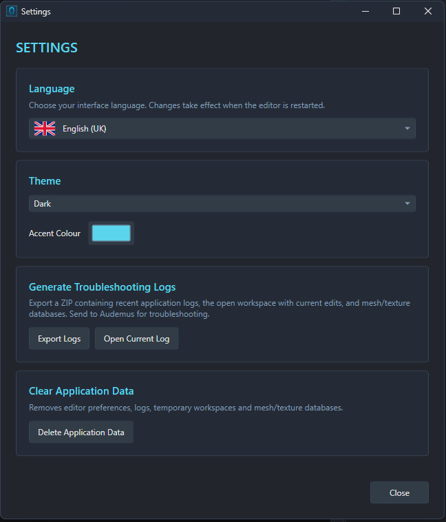

# Troubleshooting and Limitations

Start with the error message MFE gives you, then check the relevant section below. If you still can't sort it out, [export a diagnostic ZIP](#report-a-problem) and include the steps that caused it in a report either here as an Issue on Github or on the Bugs tab of the mod page.

## MFE won't start

1. Extract the complete download into a folder. Keep the executable and its accompanying files together, and run **MorphFaceEditor.exe** from that folder.
2. If Windows reports a missing .NET runtime, install the Windows **.NET 10 Desktop Runtime** from [Microsoft's download page](https://dotnet.microsoft.com/en-us/download/dotnet/10.0), then try again. Choose the Desktop Runtime for a Windows desktop app.
3. If MFE closes before you can reach Settings, look for the latest log in `%LocalAppData%\LE BioMorphFace Editor\Logs` and include it with your report.

## A game or database is unavailable

Make sure you have Mass Effect Legendary Edition properly installed, then restart MFE so it can detect it.

Open **Mesh/Texture Databases** and click **Rebuild** beside the game you need. If MFE marks an existing database as outdated, rebuild it for the current version of the editor.

After installing or removing mods, use **Rescan Mods** to refresh an existing database. Build the main database first if you haven't done that yet. Retry the import or reopen the face after the scan. For custom meshes, reimport the mesh to refresh its material choices.

If the game still doesn't show up, include that detail in your report rather than repeatedly rebuilding the other games' databases.

## Hair, accessories or textures are missing

1. Check that any mods required by the headmorph are installed for the game you're editing. A RON is only a list of of asset references, not the actual hair meshes and textures themselves.
2. Refresh that game's database and retry the import.
3. If a mod asset still doesn't appear, add its PCC asset through **Mesh/Texture Databases → Add Custom Asset**. Follow [Materials, Textures and Attachments](MATERIALS-TEXTURES-AND-ATTACHMENTS.md#adding-a-missing-texture-or-mesh) for the steps.

Player workspaces offer a narrower selection than NPC workspaces because Shepard needs assets the game can always persistently load seekfree. Adding something to the database doesn't automatically make it usable on a Player face - though pretty much all hair mods are already set up to work correctly on the player.

Read the import warnings carefully, as missing assets don't all behave the same way:

- **An existing PCSAV's unavailable hair/accessory reference:** MFE keeps the original reference unless you change it. Leave it alone if you want to preserve the saved selection while sorting out the missing preview asset.
- **A full Player RON's missing attachment:** the import can fail until the required asset is available.
- **An NPC RON's missing attachment:** MFE can skip it and import the rest of the head, with a warning.
- **A missing texture in a full headmorph RON:** MFE can skip that override and use the material's inherited texture instead. That may change the appearance, so check the result.

## The editor is empty or some controls are disabled

For a PCC, select a face and click **Load Selected Face**, double-click it, or press **Enter** with the face list focused. Selecting a row alone doesn't load it.

If you're editing a default Shepard, the PCSAV may not contain a custom headmorph. Accept the offer to create one if you want to start a custom face, then save the career when you're ready.

For missing morph controls, check **LOD** above the preview and try **LOD0**. Some features don't affect every LOD. For a Custom Mesh Workspace with no material controls, assign its material slots first.

For Female Turian faces, morph editing needs compatible geometry. Older faces with incompatible saved shapes remain available for material editing. If **Female Turian [TUF]** is missing from **New NPC Morph**, install a compatible Female Turian face and refresh the game's database. See [Create a new NPC face](NPC-FACES.md#create-a-new-npc-face) for the requirements.

Some unavailable controls are intentional; check [Known limits](#known-limits) below.

## The preview looks wrong

- Choose **Material → Shaded** for the normal appearance. Diagnostic colours and Unlit mode are inspection views.
- Choose **Lighting → Studio** to judge colours under neutral lighting. Check **Post Processing** if the overall presentation looks different from what you expected.
- Click **Front** or **¾ View** to restore a useful camera angle.
- Tick **Hair / Accessory** if the selected attachment is hidden in the preview.
- Check the texture, mask and strength settings for the affected part of the face. A colour change won't reveal a marking if its mask excludes that region or its strength is zero.

For scalp seams or a painted hairline beneath the wrong hairstyle, check the hair/scalp pairing. See [Hair and scalp matching](MATERIALS-TEXTURES-AND-ATTACHMENTS.md#hair-and-scalp-matching).

If MFE reports **Preview unavailable** or a preview failure, save your work if possible, restart the editor and try again. If it keeps happening, export logs and include the exact error.

The preview closely approximates the game, but lighting, animation and game-controlled effects can still differ. Check the saved result in game before treating a preview difference as a broken export.

### The face shape looks broken

If **Fix Morph** appears below **Load Selected Face**, MFE has found a mismatch between the saved face shape and its slider values that it can repair. Click it, check the rebuilt result and save or export the face if you're happy with it. Use **Undo** to restore the original shape. See [Fix Morph](EDITING-FACES.md#repair-a-face-with-fix-morph) for more detail.

## A RON won't import

Check which kind of RON you have (if it is a MFE RON, it will say so at the top of the file in a text editor) and then use the matching action:

| File | Action on an open face |
| --- | --- |
| Full headmorph | **Import Morph Face** |
| Morph slider preset | **Import Morphs** |
| MFE material preset | **Import Materials** |

Use a compatible game and archetype. If you need to move a full head between games, follow [Saving, Exporting and Conversion](SAVING-EXPORTING-AND-CONVERSION.md#convert-a-face-to-another-game).

For a previously exported legacy Gibbed Save Editor headmorph, open the `.me2headmorph` or `.me3headmorph` through **File → Open File** and choose LE2 or LE3 respectively. See [Player Faces](PLAYER-FACES.md) for the route into a career save.

If the message mentions missing assets or an unavailable database, sort that out before retrying the file. Changing the import action won't supply a missing hairstyle or texture.

## Saving or exporting fails

Keep MFE open while you check the error, so you can still access your edits.

For a file-access or destination error, try **Save As** to a folder you can write to, or export to a new file. If MFE says the source changed since you opened it, keep your edits in a separate output before reopening that source.

If a material or morph-only RON saves successfully but MFE still shows unsaved changes, check whether you've also edited something that format doesn't contain. Export the full headmorph or a PCC to keep those other edits.

For a face export to PCC, use **Save File** to update the currently open package. **Export to PCC** expects a different destination. Custom mesh exports create a new mesh-and-material package, so they use a different save dialog.

Read [Saving, Exporting and Conversion](SAVING-EXPORTING-AND-CONVERSION.md) for the output choices. If the failure continues, export diagnostic logs while the problem and your current edits are still available.

## The game still shows the old face

For Shepard, save the edited PCSAV and load that specific save in game. Exporting a RON alone doesn't update a career.

For an NPC, check both **Assign Morph to Actor** and **Assign Materials to Actor**, then save the PCC. Exporting a face into a package doesn't automatically assign it to an actor. Follow [NPC Faces and Actor Assignment](NPC-FACES.md) for the complete workflow.

Check that your mod uses the edited PCC and that another installed package isn't overriding it. MFE saves and exports files; it doesn't install the finished mod for you.

## Conversion fails or changes the appearance

Build databases for both games. If you're converting into an existing PCC, choose one from the target game containing an editable face of the same archetype. If it has no suitable face, create a new conversion PCC first, then export the converted face into your intended package.

Read the conversion report for unsupported sliders and asset warnings. The games don't all have the same controls, so some differences are expected. See [Convert a face to another game](SAVING-EXPORTING-AND-CONVERSION.md#convert-a-face-to-another-game).

## Known limits

| Workflow | What to expect |
| --- | --- |
| Career saves | Open Legendary Edition **PC** PCSAV files. Import legacy ME2/ME3 headmorphs through the separate Gibbed route. |
| Vorcha [ALN[  | Use material editing. Morph sliders, Fix Morph and morph conversion aren't available. |
| Unrecognised or unverified geometry | MFE may preserve the authored shape without offering morph sliders. Bone editing needs a verified rig. |
| Custom meshes | Use up to eight distinct used material slots. Bone adjustments and attachments are preview only; check [Custom Meshes](CUSTOM-MESHES.md) before exporting. |
| Actor assignment | Update existing hair/accessory components. Use Legendary Explorer for structural changes such as adding missing mesh components. |

## Report a problem

1. Leave the affected file open if possible, and wait for any active operation to finish.
2. Open **File → Settings**.
3. Under **Generate Troubleshooting Logs**, click **Export Logs** and choose where to save the ZIP.
4. Include the ZIP with your report when you send it to me.

The ZIP includes recent logs, the open workspace with current edits, and the mesh/texture databases. Exporting diagnostics doesn't save those edits back into the source file.

Include the MFE version from the title bar, the game and face type, the file format, the exact error, and the steps needed to reproduce it. Mention relevant mods or custom assets. If the file won't open at all, include the input file or a link to its download where possible.

Use **Open Current Log** in Settings if you just want to inspect the current session's log.

## Reset MFE's application data

If you need a clean MFE setup or want to fully delete all traces of it from your PC, save your work and export any useful diagnostic logs first. Open **File → Settings**, click **Delete Application Data**, then confirm **Clear and Exit**.

This clears MFE's preferences, logs, temporary workspaces and mesh/texture databases, then closes the editor. It doesn't uninstall mods or change the game installation. Restart MFE, reapply your preferences and rebuild the databases you need.

[Back to the documentation](../README.md#documentation)
